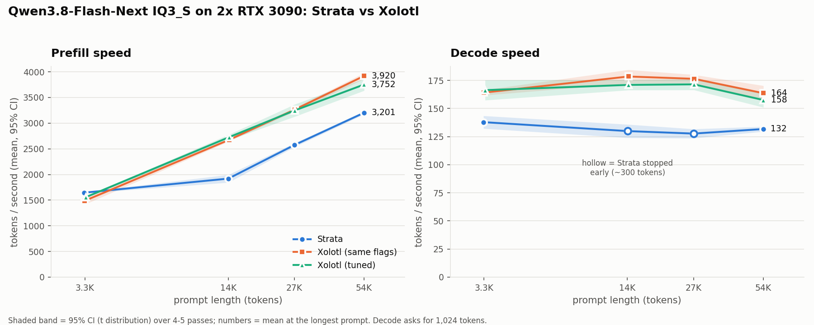
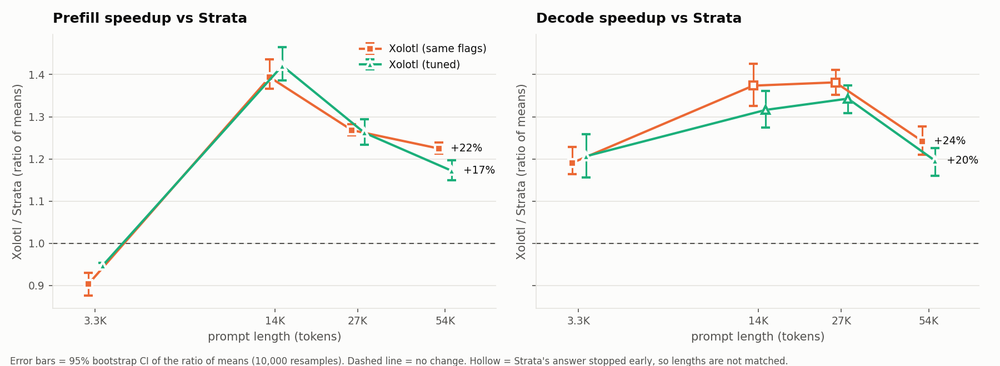
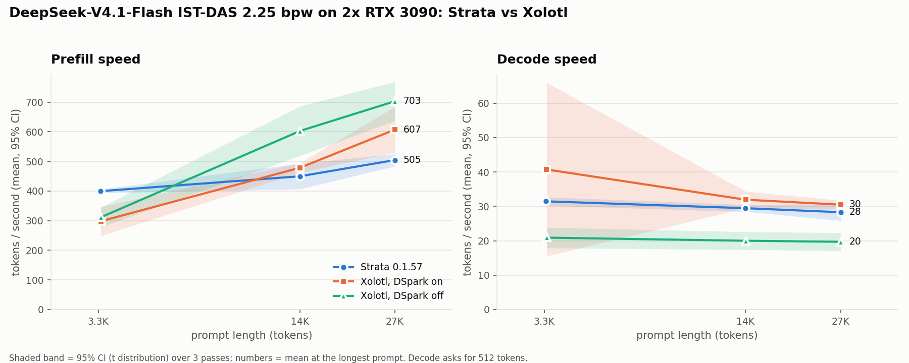
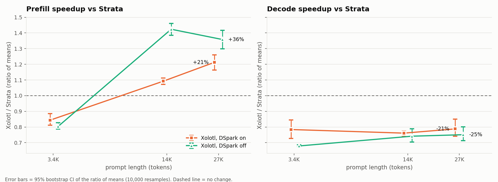

# Xolotl vs Strata on two RTX 3090s: Qwen3.8-Flash-Next and DeepSeek-V4.1-Flash

[Xolotl](https://github.com/Indras-Mirror/Xolotl) is a fork of the [Strata](https://github.com/Niko1221/Strata)
MoE inference engine. This repo measures whether swapping Strata's engine for Xolotl's makes the same model faster
on the same machine. For Qwen3.8-Flash-Next, the model, quant, pack, MTP draft, expert profile and flags are all
unchanged. DeepSeek-V4.1-Flash is a second test; see [DeepSeek-V4.1-Flash](#deepseek-v41-flash) below.

**DeepSeek-V4.1-Flash, in short:** one Xolotl setting decides the result. At its default, Xolotl's DeepSeek engine
decoded **21–25% slower** than Strata's at every prompt length. With `--tier-batch-pcie 0.25`, which Xolotl's docs
recommend for CPUs with many cores and memory channels, it decoded **11% faster** than Strata at 14K prompt tokens
(32.3 vs 29.0 tok/s). That second number is from one length, 3 passes.

**Qwen3.8-Flash-Next, with identical flags:**

- **Decode is about 20% faster** when both engines write the same number of tokens: 138 → 164 tok/s at 3.3K
  prompt tokens and 132 → 164 tok/s at 54K. Where Strata's answers stopped early, the gap was 32–38%.
- **Prefill is 23–39% faster from 14K prompt tokens up, but 10% slower at 3.3K.** The gain peaks at 14K, which
  happens to be Strata's weakest point, and shrinks as prompts get longer.
- **Xolotl's recommended QFN flags didn't help on this machine.** They were within a few percent of the
  identical-flags run either way.





## Setup

| | |
| --- | --- |
| GPUs | 2x NVIDIA RTX 3090 (24 GB each), layer split across both (`"gpu": [1, 0]`, `"layer_split": "auto"`) |
| CPU / RAM | AMD EPYC 7C13 64-core (AVX2, no AVX-512), 503 GB RAM |
| Software | Ubuntu, kernel 6.8.0, NVIDIA driver 580.178.04, CUDA 12.8 |
| Model | Qwen3.8-Flash-Next GSQ-RCO **IQ3_S** (125B MoE, two GGUF shards, 46.8 GiB) |
| Strata | 0.1.39, commit `6f32ec0` (prebuilt engine from `setup.sh`) |
| Xolotl | commit `8486ead` (7 Nov 2026), built from source for sm_86 against llama.cpp `6050b467` + Xolotl's ggml patch |

Engine flags, identical for A and B:

```
--expert-cache auto --prefill auto --spec 4 --spec-min-p 0.5 --mtp <mtp/rt>
--max-context 131072 --kv int8 --kv-resident 32768 --remote-expert-opt
```

## The three configs

| Config | Engine | What changes |
| --- | --- | --- |
| **A** | Strata | Nothing: the working Strata config as-is (baseline) |
| **B** | Xolotl | The engine binary only |
| **C** | Xolotl | B + Xolotl's QFN settings from its `configs/xol-qfn.json`: `--ple-io direct`, `STRATA_ROUTE_RESIDENT=0.8`, `STRATA_ROUTE_RESIDENT_RANKS=5-9` |

## Method

The test uses Xolotl's `tools/throughput.py` probe. One pass:

1. **Prefill:** a fresh prompt of source code, 1 token out. The text comes from a new offset in the corpus each time,
   so nothing is reused from cache.
2. **Decode:** on that context, ask for a 1,024-token code answer, thinking off, temperature 0.
3. **Agent turn:** add a short user message on top. This step isn't reported, because the turn size depends on how
   long the previous answer was.

All speeds are the server's own timings, not wall-clock time.

**Context sweep (8 Nov 2026):** prompts of 3.3K, 14K, 27K and 54K tokens (the probe's 4K/16K/32K/64K targets), with
5 passes at each length. The model, pack and MTP files were read into the page cache first. Each config's server
started once and ran one warm-up pass, which was discarded. Configs ran one after another, never at the same time.

**Confidence intervals:** speeds are means with a 95% CI from the t distribution. Speedups are the ratio of the two
means, with a 95% bootstrap CI from 10,000 resamples.

## Results

### Prefill (tokens/s, mean ± 95% CI)

| Prompt | A: Strata | B: Xolotl, same flags | B / A | C: Xolotl, tuned | C / A |
| ---: | ---: | ---: | ---: | ---: | ---: |
| 3.3K | 1,646 ± 14 | 1,487 ± 71 | **0.90** (0.88–0.93) | 1,559 ± 14 | 0.95 (0.94–0.95) |
| 14K | 1,920 ± 76 | 2,676 ± 28 | **1.39** (1.37–1.44) | 2,728 ± 55 | 1.42 (1.39–1.47) |
| 27K | 2,573 ± 38 | 3,263 ± 35 | **1.27** (1.26–1.28) | 3,248 ± 120 | 1.26 (1.23–1.29) |
| 54K | 3,201 ± 31 | 3,920 ± 59 | **1.23** (1.21–1.24) | 3,752 ± 118 | 1.17 (1.15–1.20) |

### Decode (tokens/s, mean ± 95% CI)

| Prompt | A: Strata (tokens written) | B: Xolotl, same flags | B / A | C: Xolotl, tuned | C / A |
| ---: | ---: | ---: | ---: | ---: | ---: |
| 3.3K | 137.8 ± 5.7 (1,024) | 164.1 ± 2.4 | **1.19** (1.16–1.23) | 166.3 ± 8.9 | 1.21 (1.16–1.26) |
| 14K | 129.9 ± 5.9 (285) | 178.4 ± 6.0 | 1.37 (1.33–1.43) | 171.0 ± 4.6 | 1.32 (1.27–1.36) |
| 27K | 127.7 ± 4.1 (315) | 176.4 ± 3.7 | 1.38 (1.35–1.41) | 171.5 ± 5.0 | 1.34 (1.31–1.37) |
| 54K | 131.7 ± 2.2 (1,024) | 163.6 ± 6.7 | **1.24** (1.21–1.28) | 157.5 ± 6.5 | 1.20 (1.16–1.23) |

Xolotl wrote all 1,024 tokens in every pass. Strata wrote all 1,024 at 3.3K and 54K, but stopped early (285–315
tokens on average) at 14K and 27K. So only the 3.3K and 54K rows compare equal-length answers, and they are the
bold ones. Strata's own speed barely changed with answer length (128–138 tok/s), which suggests the 14K and 27K
gaps are roughly right. The safe claim is still the matched one: about +20%.

All numbers are in [results/sweep/summary.csv](results/sweep/summary.csv), and each pass has its own JSON under
`results/sweep/<config>/`.

### Reading the results

- **Prefill depends on prompt length.** Both engines get faster with longer prompts, but in different ways.
  Strata gains little from 3.3K to 14K (1,646 → 1,920) and then climbs. Xolotl starts lower, jumps by 14K
  (1,487 → 2,676) and then rises more slowly. Its biggest advantage, about 40%, lands at 14K, where Strata is
  weakest. An earlier test of 14K prompts alone therefore overstated the overall prefill gain.
- **The decode gain is smaller with longer prompts.** Xolotl was 19–24% faster at the two matched lengths. Its own
  decode peaked at 14–27K (176–178 tok/s) and dropped at 54K (164 tok/s).
- **The tuned flags (C) were a wash.** They were 5% faster than B on 3.3K prefill and 4% slower on 54K prefill.
  Decode was the same within the CIs.

### What made Xolotl faster

This test doesn't isolate the cause. Two differences show up in the logs:

- Xolotl turns on nine bit-exact speed switches for Ampere (sm_86) cards by default. The Strata 0.1.39 binary
  doesn't have them.

  ```
  strata: sm_86 (Ampere): 9 exact speed switches on by default (STRATA_SM86_PERF=0 turns them off ...)
  ```

- Xolotl's prompt pipeline uses a 384-slot ring, against Strata's 96 slots (`prompt chunk auto: 8192 tokens, a
  384-slot ring`).

Rerunning B with `STRATA_SM86_PERF=0` would show how much of the gain comes from the speed switches.

## Earlier runs at 14K only

Before the sweep, two sessions ran 2 passes per config at ~14K tokens only. They agree with the sweep's 14K row.

| Session | A prefill / decode | B prefill / decode | C prefill / decode |
| --- | ---: | ---: | ---: |
| 7 Nov, cold page cache | 1,956 / 127.8 | 2,688 / 174.3 | 2,671 / 166.0 |
| 8 Nov, warm page cache | 1,889 / 124.0 | 2,698 / 174.6 | 2,650 / 165.6 |

Data is in [results/2026-11-07-cold/](results/2026-11-07-cold/) and
[results/2026-11-08-warm/](results/2026-11-08-warm/). The first session's full logs were lost when a reboot
cleared the temp folder they were in.

### Load time

Load time is the time until the server first answered. With a warm cache, the configs loaded in 20–30 s, and Strata
was fastest. In the cold session, C loaded in 27 s against B's 42 s. The cause was B's engine: it picked
`--ple-io ram` and read the model's 26.8 GiB PLE (per-layer embedding) table from disk into RAM, which took 15.2 s.
With a warm cache the same step took 2.5 s. `--ple-io direct` only saves load time when the table isn't already in
the page cache. The trade-off is RAM against disk: `ram` keeps 26.8 GiB of RAM in use while the server runs, and
`direct` reads the drive on every token.

## Caveats

- **Strata stopped early at 14K and 27K.** See the decode table: only 3.3K and 54K compare equal-length answers.
- **Strata failed 2 of its 20 sweep passes.** One failed at 27K and one at 54K, each with
  `the engine reported an error: malformed tool call` from Strata's server (HTTP 400). Those points use 4 passes.
  The same error happened once before the sweep. Xolotl had no failures.
- **The probe prompt is source code.** In earlier normal use, the same Strata config prefilled 13–15K-token prompts
  at 2,670–2,930 tok/s, against 1,920 on the probe at 14K. Prompt content changes prefill speed, so other workloads
  may show a smaller or larger gap.
- **B's 14K points come from a second server session.** The project folder was renamed during the first sweep and
  those results weren't saved, so B was restarted for that one length. Its 14K numbers match the earlier sessions
  (2,676 vs 2,688–2,698 prefill).
- **Xolotl's own headline numbers** (150–199 tok/s decode) are for a different quant, the
  [XQ 45 GB](https://huggingface.co/IndrasMirror/Qwen3.8-Flash-Next-Swift-1.5-XQ-Uncensored) build, measured on one
  RTX 4090. This test used the IQ3_S quant on two 3090s.

## DeepSeek-V4.1-Flash

**Result:**

- **With `--tier-batch-pcie 0.25`, Xolotl's decode is 11% faster than Strata's at 14K prompt tokens:** 32.3 ± 1.3
  against 29.0 ± 0.2 tok/s (ratio 1.11, 95% CI 1.10–1.13). Prefill was about the same as at the default setting.
  See [The setting that mattered](#the-setting-that-mattered---tier-batch-pcie).
- **At the default (`--tier-batch-pcie 1.0`), Xolotl's decode is 21–25% slower at every length:** 31.5 → 24.7 tok/s
  at 3.4K prompt tokens and 28.0 → 22.0 tok/s at 27K. Every pass on both engines wrote all 512 tokens, so the
  answers are equal length.
- **Prefill is 16% slower at 3.4K and 9–21% faster from 14K up** (default setting). With Xolotl's DSpark draft model
  turned off, long-prompt prefill was faster still: 36–42% ahead of Strata.
- **DSpark helped Xolotl's decode only at 3.4K** (24.7 vs 21.4 tok/s, default setting) and cost it prefill from 14K
  up. Strata turned DSpark off by itself on this machine (see below).

The charts and the full sweep tables below are for the default setting. The `--tier-batch-pcie` runs covered 14K
prompts only.





This test is not an engine-binary swap like the Qwen one. Both projects ship a separate engine for DeepSeek-V4.1,
with its own flags, so each engine runs with its own settings. The settings were picked to match output quality
where the flags allow it.

### Setup

| | |
| --- | --- |
| Model | DeepSeek-V4.1-Flash-1017 GSQ-RCO **IQ2_XS** by ISTA-DASLab ("IST-DAS 2.25 bpw" in Strata's setup): 4 GGUF shards, 145 GB, plus the Engram table (IQ4_NL, 110.6 GB) and the DSpark draft model (Q8_0, 8.0 GB) |
| Strata | Terminal 0.1.57; its DeepSeek engine `strata-dsv41` 0.1.59 (prebuilt, from setup) |
| Xolotl | `ds41_generate` from commit `8486ead`, built for sm_86, run through Xolotl's `tools/v41/serve/serve_ds41.py` and `ds41-engine.sh` |
| GPUs / CPU / RAM | Same machine as the Qwen test. Both engines split the 40 layers across the two cards, layers 0–19 and 20–39 |

**Strata**: the config its setup wrote, unchanged except for the port.

```
--max-context 131072 --eos 1 --vision on --dspark auto --dspark-conf 0.65 --tp 2 --reserve-mib 900
```

**Xolotl**: Xolotl's serve config (`tools/v41/serve/strata-ds41.json`), with three changes so the output matches
Strata's more closely.

```
--backend cuda --experts gpu --engram <Engram-IQ4_NL.gguf> --rank configs/ds41-rank.bin
--ctx 131072 --stop 1 --arena-adapt --arena-gib 150 --route-bias 0 --route-bias-file 0
--prompt-batch 12288 --layer-split auto
env STRATA_SERVE_DSPARK=<dspark-...-Q8_0.gguf>   (empty for the DSpark-off run)
```

- **Exact routing:** `--route-bias 0 --route-bias-file 0`. Xolotl's serve config ships 0.5 and 0.3, which steer tokens
  toward experts already in VRAM. Its own docs say this trades quality for speed, so it was turned off.
- **No `--kv-fp4`:** the shipped config stores the KV cache in 4 bits. This run uses the engine's default 16-bit
  cache.
- **The same expert ranking as Strata:** `--rank` decides which experts go into VRAM first. Without it the engine
  starts at layer 0, expert 0. [scripts/ds41_rank_from_profile.py](scripts/ds41_rank_from_profile.py) turns the
  expert profile in Strata's pack (routing counts per expert) into Xolotl's rank file.

`ds41-engine.sh` adds its own defaults on top. Two of them matter here:

- DSpark runs 4 tokens deep, at confidence 0.6, with the draft's experts cut to the 64 most used per layer.
- The dense weights (attention, shared expert, head) are re-quantized from Q8_0 to Q6_K at load. This saves about
  1.7 GB of VRAM for expert slots. It is lossy; Xolotl measured a small KL increase (0.2281 → 0.2306).

### Where the experts live

Strata kept 3,672 of the 15,360 routed experts in VRAM, with about 880 MiB left free on each card. The other 113 GB of
experts were read in place from the model files, through the page cache.

Xolotl copied all 15,360 experts into a pinned RAM arena (67.9 GiB per card's half of the layers), so nothing came
from disk. It held 3,300–4,100 experts in VRAM, with the most just after load. It empties that cache for each prompt and refills it before decode.

Strata didn't load DSpark at all:

```
ds4: DSpark not loaded: the routed experts (149 GB) are far more than the GPU holds (47 GB), where its verify
rounds read 3.3x a token's bytes and gain nothing (--dspark on loads it anyway)
```

Xolotl ran DSpark at 3.1–3.3 tokens per verify pass. That gave it 15% more decode speed at 3.4K, and nothing
measurable at 14K and 27K.

### Method

Same probe and sweep script as the Qwen test. The differences: prompts of 3.4K, 14K and 27K tokens (the probe's
4K/16K/32K targets), **3 passes** per length, and **512-token** answers. Each server started once and ran one
discarded warm-up pass, and the configs ran one after another. 27 of 27 passes succeeded.

### Prefill (tokens/s, mean ± 95% CI)

| Prompt | Strata | Xolotl, DSpark on | / Strata | Xolotl, DSpark off | / Strata |
| ---: | ---: | ---: | ---: | ---: | ---: |
| 3.4K | 364 ± 7 | 307 ± 36 | **0.84** (0.81–0.89) | 293 ± 20 | 0.80 (0.79–0.83) |
| 14K | 430 ± 12 | 470 ± 19 | **1.09** (1.07–1.11) | 613 ± 41 | 1.42 (1.39–1.46) |
| 27K | 483 ± 49 | 585 ± 30 | **1.21** (1.16–1.26) | 656 ± 49 | 1.36 (1.30–1.42) |

### Decode (tokens/s, mean ± 95% CI, 512 tokens every pass)

| Prompt | Strata | Xolotl, DSpark on | / Strata | Xolotl, DSpark off | / Strata |
| ---: | ---: | ---: | ---: | ---: | ---: |
| 3.4K | 31.5 ± 0.6 | 24.7 ± 4.6 | **0.78** (0.73–0.85) | 21.4 ± 0.5 | 0.68 (0.67–0.69) |
| 14K | 29.0 ± 0.2 | 22.1 ± 1.4 | **0.76** (0.74–0.77) | 21.5 ± 3.2 | 0.74 (0.70–0.79) |
| 27K | 28.0 ± 0.8 | 22.0 ± 4.1 | **0.79** (0.74–0.85) | 21.0 ± 3.3 | 0.75 (0.71–0.80) |

All numbers are in [results/sweep-ds41/summary.csv](results/sweep-ds41/summary.csv), and each pass has its own JSON
under `results/sweep-ds41/<config>/`.

### The setting that mattered: `--tier-batch-pcie`

When an expert is in Xolotl's RAM arena but not in VRAM, the engine either copies it to the card over PCIe or
computes it on the CPU. `--tier-batch-pcie` is the share sent over PCIe for batched passes, which include every
DSpark decode and verify step. At the default of 1.0 the CPU never computes experts. Xolotl's docs
([DEEPSEEK_V41.md](https://github.com/Indras-Mirror/Xolotl/blob/main/docs/DEEPSEEK_V41.md)) say to set it low on
CPUs with many cores and memory channels, and to sweep 1.0, 0.5 and 0.0. This machine's EPYC 7C13 has 64 cores and
8 DDR4 channels. A [Reddit post](https://www.reddit.com/r/LocalLLaMA/comments/1xlec67/getting_incredible_results_with_a_single_rtx/)
running the same engine on a 64-core Threadripper used 0.25.

Same config as the DSpark-on run above, plus `--tier-batch-pcie`. Prompts of 14K tokens, 3 passes, 512-token answers:

| `--tier-batch-pcie` | Prefill (tok/s) | / Strata | Decode (tok/s) | / Strata |
| ---: | ---: | ---: | ---: | ---: |
| Strata (reference) | 430 ± 12 | | 29.0 ± 0.2 | |
| 1.0 (default) | 470 ± 19 | 1.09 (1.07–1.11) | 22.1 ± 1.4 | 0.76 (0.74–0.77) |
| 0.5 | 454 ± 47 | 1.05 (1.02–1.10) | 31.4 ± 9.1 | 1.08 (0.98–1.22) |
| **0.25** | 477 ± 86 | 1.11 (1.02–1.17) | **32.3 ± 1.3** | **1.11** (1.10–1.13) |
| 0 | 461 ± 25 | 1.07 (1.05–1.09) | 26.7 ± 1.1 | 0.92 (0.90–0.93) |

- **0.25 was best and the most consistent:** 31.9–32.9 tok/s across its passes. 0.5 averaged close but swung from
  28.4 to 35.5. At 0, where the CPU computes every expert that isn't in VRAM, decode fell back to 26.7. The best
  split uses both the CPU and PCIe.
- **Prefill didn't change** beyond noise. The ±86 at 0.25 comes from one slow first pass (437 against 497–498).
- **Decode went from 0.76× to 1.11× Strata** without any lossy setting: routing stays exact and the KV cache stays
  16-bit.

These three configs ran in a separate server session after the main sweep, so the Strata and 1.0 rows come from the
earlier session. Data: `results/tbp-ds41/`.

### Reading the DeepSeek results

- **Xolotl's slower decode at the default came from `--tier-batch-pcie`.** Both engines held about the same number
  of experts in VRAM (3,672 against 3,300–4,100), so VRAM wasn't the difference. Moving part of the RAM-held experts
  to the CPU took Xolotl from 22.1 to 32.3 tok/s at 14K.
- **Xolotl's prefill gain grows with prompt length**, as it did on Qwen. Its prompt path runs a 12,288-token
  layer-major batch.
- **DSpark costs Xolotl prefill.** Its 4.4 GB of draft weights sit on the card. With DSpark off, the 14K and 27K
  prompts read 30% and 12% faster, and decode lost only about 1 tok/s at those lengths.
- **Strata's choice to skip DSpark held up at the default setting.** Xolotl's DSpark-on and DSpark-off decode were
  the same within the CIs from 14K up. DSpark off wasn't retested at `--tier-batch-pcie 0.25`.

### DeepSeek caveats

- **The settings aren't identical.** Strata's config has image input on (`--vision on`). Xolotl's has it off,
  because Xolotl's server refuses images with ISTA-DASLab's files (they lack the router's image bias). Xolotl
  re-quantizes the dense weights to Q6_K and Strata doesn't. Strata's flags for its own KV cache and routing were
  left at its defaults.
- **3 passes per point.** Some of Xolotl's decode CIs are wide: up to ±4.6 tok/s in the default sweep, and ±9.1 at
  `--tier-batch-pcie 0.5`. The default-setting gap is larger than ±4.6 at every length, and the 0.25 result's CI is
  ±1.3.
- **`--tier-batch-pcie 0.25` was measured at 14K only.** It wasn't run at 3.4K or 27K, or with DSpark off. Strata
  wasn't tuned either: its config is what its setup wrote.
- **Two GPUs, layer split.** Both engines split the layers across both cards. Xolotl's published DeepSeek numbers are
  on one card; single-card runs weren't tested here.
- **Load time isn't compared.** The page cache was warm from the download and from the earlier runs. Time to first
  answer was 24 s for Strata, 48 s for Xolotl with DSpark, and 30 s without.
- **A different quant from the old Strata setup.** The machine previously ran Unsloth's UD-Q8_K_XL. Xolotl's engine
  can't read that set's MXFP8 Engram table, so both engines used ISTA-DASLab's IQ2_XS here.

## Reproduce

These steps are for the Qwen test. The DeepSeek steps follow them.

1. Build Xolotl's engine. This takes about 5 minutes on 64 cores.

   ```bash
   XOLOTL_DIR=~/Xolotl CUDA_ARCH=86 ./scripts/build_xolotl.sh
   ```

   `ninja` must be on `PATH`. Strata's `.venv` has it, or run `pip install ninja`.

2. Generate the three configs from your working Strata config.

   ```bash
   python3 scripts/make_configs.py ~/Strata/strata-iq3_s.json ~/Xolotl
   ```

3. Run the context sweep. It takes about 40 minutes for three configs, 4 lengths and 5 passes. `WARM_FILES` reads
   the model into the page cache first.

   ```bash
   STRATA_DIR=~/Strata XOLOTL_DIR=~/Xolotl \
   WARM_FILES="<model dir>/*.gguf <pack dir>/*.bin <mtp dir>/*" \
   ./scripts/sweep.sh | tee results/sweep-console.log
   ```

4. Make the plots and `summary.csv`.

   ```bash
   python3 -m venv .venv && .venv/bin/pip install matplotlib numpy
   .venv/bin/python scripts/plot.py
   ```

Nothing else may be using the GPUs or port 8098 during a run. Don't rename or move the repo folder while a sweep is
running. The Xolotl server needs Python's `regex` package. Strata's `.venv` interpreter works for both servers, and
the scripts use it by default.

For a quick check at one length, use `scripts/run_all.sh`. It runs 2 passes per config at ~14K tokens.

The configs in `configs/` were generated for this machine and are kept for reference. Their paths are specific to
it.

### DeepSeek-V4.1-Flash

1. Install the model with Strata's setup (Terminal 0.1.57). Pick **IST-DAS 2.25bpw**. It downloads 274 GB and
   builds the pack.
2. Build Xolotl's DeepSeek engine into `build-ds41`. `ds41-engine.sh` picks that folder up by itself.

   ```bash
   cmake -S ~/Xolotl -B ~/Xolotl/build-ds41 -G Ninja -DCMAKE_BUILD_TYPE=Release -DSTRATA_ENABLE_CUDA=ON \
         -DSTRATA_GGML_CUDA=ON -DGGML_CUDA=ON -DCMAKE_CUDA_ARCHITECTURES=86 \
         -DSTRATA_GGML_DIR=$HOME/Xolotl/third_party/llama.cpp
   ninja -C ~/Xolotl/build-ds41 ds41_generate
   ```

3. Make the rank file from Strata's pack. Then edit the paths in `configs/ds41-*.json` and `configs/ds41-*.bench`.

   ```bash
   python3 scripts/ds41_rank_from_profile.py <Strata-data>/packs/deepseek-v4.1-flash-ist-das-2.25bpw/expert-profile.bin \
       configs/ds41-rank.bin
   ```

4. Run the sweep. It takes about 35 minutes for the three configs. Each `.bench` file tells `sweep.sh` which server
   script and Python to start.

   ```bash
   STRATA_DIR=~/Strata XOLOTL_DIR=~/Xolotl CONFIGS="ds41-strata ds41-xolotl ds41-xolotl-nodspark" \
   CONTEXTS="4000 16000 32000" PASSES=3 DECODE=512 SWEEP_OUT=$PWD/results/sweep-ds41 READY_TIMEOUT=3600 \
   ./scripts/sweep.sh | tee results/sweep-ds41-console.log
   ```

   The `--tier-batch-pcie` test uses `CONFIGS="ds41-xolotl-tbp0 ds41-xolotl-tbp025 ds41-xolotl-tbp05" CONTEXTS=16000
   SWEEP_OUT=$PWD/results/tbp-ds41` with the same other settings.

5. Make the plots and `summary.csv`.

   ```bash
   .venv/bin/python scripts/plot.py results/sweep-ds41 --prefix ds41_ --speedup-legend "lower right" --split-labels \
       --series "ds41-strata=Strata 0.1.57;ds41-xolotl=Xolotl, DSpark on;ds41-xolotl-nodspark=Xolotl, DSpark off" \
       --title "DeepSeek-V4.1-Flash IST-DAS 2.25 bpw on 2x RTX 3090: Strata vs Xolotl"
   ```

`ds41-engine.sh` runs the engine under `systemd-run --user` with a memory cap of `DS41_MEMORY_MAX` (default 100G),
and takes a lock file at `DS4_LOCK`. The configs set these to 400G and `/tmp/xolotl-ds41-gpu.lock`.

## Files

```
scripts/build_xolotl.sh   clone + build Xolotl's strata engine
scripts/make_configs.py   base Strata config -> A/B/C configs
scripts/sweep.sh          context sweep: each config x prompt lengths x passes
scripts/plot.py           charts + summary.csv from the sweep (95% CIs)
scripts/bench.sh          one config: start server, probe twice, stop
scripts/run_all.sh        quick check: A, B, C at ~14K, 2 passes each
scripts/ds41_rank_from_profile.py   Strata's DeepSeek expert profile -> Xolotl's --rank file
configs/                  the configs used here (ds41-* = DeepSeek; *.bench = which server sweep.sh starts)
docs/                     the charts (ds41_* = DeepSeek)
results/sweep/            Qwen context sweep: per-pass JSON, engine logs, summary.csv
results/sweep-ds41/       DeepSeek context sweep, same layout
results/tbp-ds41/         DeepSeek --tier-batch-pcie 0 / 0.25 / 0.5 at 14K
results/ds41-setup.log    Strata's DeepSeek download and pack build
results/2026-11-0*/       earlier 14K-only sessions
```
